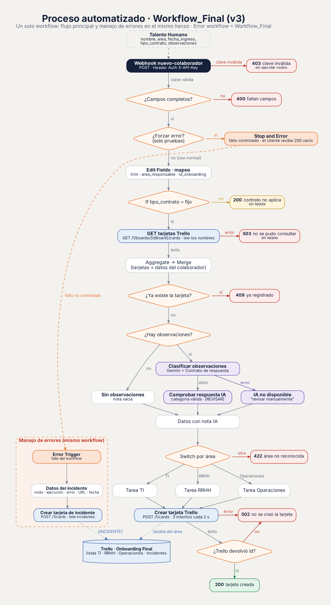

# Onboarding de colaboradores con n8n

Automatización inteligente del ingreso de nuevos colaboradores: un webhook recibe la solicitud de Talento Humano, valida los datos, evita duplicados, usa IA (Google Gemini) para clasificar las observaciones y crea una tarjeta en la lista de Trello del área responsable (TI, RRHH u Operaciones).

**Curso:** Automatización inteligente con n8n · EAM · 2026 II
**Profesor:** Robert Garcia Rey

## 1. Identificación

**Integrantes**

- Manuela Camacho Llano
- Sofía Pérez Vanegas
- Karol Dahiana Vanegas Arteaga
- Valeria Cerón Muñoz
- Juan Miguel Cerón Ocampo

**Problema.** Cuando ingresa un colaborador, Talento Humano debe avisar a tres áreas lo que tienen que dejar listo antes del primer día. Hecho a mano, cada aviso depende de que alguien lo recuerde, no hay una revisión confiable de duplicados y no queda un registro común de lo pedido ni de los fallos.

**Objetivo.** Recibir la solicitud en un solo punto, validarla y crear la tarjeta del área con sus tareas iniciales y una nota de la IA sobre las observaciones. La respuesta a Talento Humano debe corresponder a lo que realmente pasó en Trello.

**Alcance de la versión final.** Contratos `fijo`; áreas TI, RRHH y Operaciones; una tarjeta por colaborador y área; clasificación de observaciones con IA; y registro de fallos no controlados en la lista Incidentes. No ejecuta las tareas (la tarjeta solo las asigna) ni envía notificaciones por correo o chat. El detalle está en la [documentación](documentacion/Documentacion_Proyecto_Final.md).

## 2. Vista general

Todo el proceso está en **un solo workflow** (`Workflow_Final`), sin subworkflows.

1. `Webhook nuevo-colaborador` recibe un `POST` autenticado con la cabecera `X-API-Key`.
2. Valida los campos obligatorios y que el contrato sea `fijo`.
3. Consulta las tarjetas del tablero en Trello y comprueba que el colaborador no esté ya registrado.
4. Si hay observaciones, **Gemini** las clasifica (`equipos_accesos`, `documentos` u `otro`) y las resume; lo ambiguo se marca con `[REVISAR]`.
5. El `Switch por área` envía el caso a `Tarea TI`, `Tarea RRHH` o `Tarea Operaciones` y se crea la tarjeta en la lista correspondiente.
6. Si algo falla sin control, el mismo workflow actúa como Error workflow y crea una tarjeta `[INCIDENTE]` en la lista Incidentes.

**Servicios:** n8n, Trello (API REST) y Google Gemini.
**Función de la IA:** clasificar y resumir las observaciones libres. La IA **no decide la ruta** (la define el campo `area`), no tiene herramientas y no actúa sobre Trello: solo devuelve texto que el flujo valida. Si falla, la tarjeta se crea igual con la nota "revisar manualmente".



## 3. Requisitos

| Recurso | Detalle |
|---|---|
| n8n | Versión [COMPLETAR VERSIÓN DE N8N], ejecutado en local (`http://localhost:5678`). No se necesita un servidor público |
| Trello | Cuenta propia y un tablero con cuatro listas: `TI`, `RRHH`, `Operaciones` e `Incidentes` |
| Credenciales de Trello | API Key y Token (permisos de lectura y escritura sobre el tablero) |
| Google Gemini | Cuenta de Google y una API key de [Google AI Studio](https://aistudio.google.com). Modelo usado: `models/gemini-3.5-flash-lite` |
| Cliente HTTP | PowerShell (`Invoke-RestMethod`) o `curl` para enviar la solicitud de prueba |

## 4. Configuración

### 4.1 Tablero de Trello

1. Crea un tablero (por ejemplo, "Onboarding Final") con las listas `TI`, `RRHH`, `Operaciones` e `Incidentes`.
2. Obtén los identificadores con la sesión de Trello iniciada en el navegador. El código del tablero es lo que va después de `/b/` en su URL:
   - Abre `https://trello.com/1/boards/{codigoDelTablero}/lists`: devuelve el `id` y el `name` de cada lista.
   - El `id` largo del tablero aparece en `https://trello.com/b/{codigoDelTablero}.json`.
3. Anota el ID del tablero y el de cada lista.

### 4.2 Credenciales en n8n

Crea tus propias credenciales (en **Credentials → Create credential**). El repositorio no contiene claves ni tokens.

| Credencial | Cómo crearla |
|---|---|
| **Trello API** | En `https://trello.com/power-ups/admin` crea un Power-Up (**Nuevo**), abre **Autenticación Trello** y copia la **clave de API**; con el enlace "token" genera un token. En n8n pega la clave en *API Key* y el token en *API Token* (deja *OAuth Secret* vacío) |
| **Header Auth** | *Name*: `X-API-Key`. *Value*: una clave larga que inventes |
| **Google Gemini (PaLM) API** | En AI Studio, **Get API key**. Pégala en *API Key* |

## 5. Importación y ejecución

1. En n8n crea un workflow nuevo y usa **⋯ → Import from File** con [`workflows/Workflow_Final.json`](workflows/Workflow_Final.json).
2. **Asigna las credenciales** en los nodos que muestren advertencia:

   | Nodo | Credencial |
   |---|---|
   | `Webhook nuevo-colaborador` | Header Auth |
   | `Modelo Gemini - seleccionar credencial` | Google Gemini (PaLM) API |
   | `GET tarjetas Trello`, `Crear tarjeta Trello`, `Crear tarjeta de incidente en Trello` | Trello API |

3. **Reemplaza los identificadores.** El archivo trae los del tablero del equipo, que no existen en tu cuenta:

   | Nodo | Campo | Valor que debes poner |
   |---|---|---|
   | `GET tarjetas Trello` | URL: `https://api.trello.com/1/boards/{ID}/cards` | ID de tu tablero |
   | `Tarea TI` | `id_lista` | ID de la lista TI |
   | `Tarea RRHH` | `id_lista` | ID de la lista RRHH |
   | `Tarea Operaciones` | `id_lista` | ID de la lista Operaciones |
   | `Crear tarjeta de incidente en Trello` | parámetro `idList` del cuerpo | ID de la lista Incidentes |

4. **Modo de prueba:** pulsa **Execute workflow**; el webhook escucha una petición en `http://localhost:5678/webhook-test/f2e06355-4a3f-44db-8b35-f3461532ca5c`.
5. **Producción:** pulsa **Publish**. El webhook queda activo en `http://localhost:5678/webhook/f2e06355-4a3f-44db-8b35-f3461532ca5c`.
6. **Registro de incidentes:** con el workflow publicado, abre **⋯ → Settings**, en **Error workflow** elige `Workflow_Final` y guarda. El identificador que trae el archivo corresponde a la instalación original; sin este paso no se crean tarjetas de incidente.
7. **Al terminar las pruebas,** despublica el workflow (**Unpublish**) para que el webhook deje de responder. El workflow no usa ejecuciones programadas.

## 6. Ejemplo reproducible

**Condiciones iniciales:** tablero con las cuatro listas y sin tarjetas de "Laura Gómez Prueba"; workflow importado, con credenciales e IDs reemplazados; en modo prueba, con **Execute workflow** pulsado justo antes de enviar.

**Entrada (datos ficticios):**

```json
{
 "nombre": "Laura Gómez Prueba",
 "area": "TI",
 "fecha_ingreso": "2026-12-01",
 "tipo_contrato": "fijo",
 "observaciones": "Necesita portátil y correo institucional antes del primer día"
}
```

**PowerShell** (cambia `TU_CLAVE` por el *Value* de tu credencial Header Auth):

```powershell
$h = @{ "X-API-Key" = "TU_CLAVE" }
$body = '{"nombre":"Laura Gómez Prueba","area":"TI","fecha_ingreso":"2026-12-01","tipo_contrato":"fijo","observaciones":"Necesita portátil y correo institucional antes del primer día"}'
Invoke-RestMethod -Method Post -Uri "http://localhost:5678/webhook-test/f2e06355-4a3f-44db-8b35-f3461532ca5c" -Headers $h -ContentType "application/json; charset=utf-8" -Body ([System.Text.Encoding]::UTF8.GetBytes($body))
```

**curl:**

```bash
curl -X POST "http://localhost:5678/webhook-test/f2e06355-4a3f-44db-8b35-f3461532ca5c" \
  -H "X-API-Key: TU_CLAVE" -H "Content-Type: application/json" \
  -d '{"nombre":"Laura Gómez Prueba","area":"TI","fecha_ingreso":"2026-12-01","tipo_contrato":"fijo","observaciones":"Necesita portátil y correo institucional antes del primer día"}'
```

**Resultado esperado:**

- La respuesta es `{"ok": true, "mensaje": "Tarjeta creada en Trello"}`.
- **Dónde consultarlo:** en tu tablero de Trello, lista **TI**, aparece la tarjeta **"Onboarding Laura Gómez Prueba · TI"**. Su descripción trae las tareas iniciales de TI y una línea `Observaciones (IA) · equipos_accesos: ...` generada por Gemini.

**Otras situaciones para comprobar** (pulsa de nuevo **Execute workflow** antes de cada envío):

| Cambio en la solicitud | Respuesta | ¿Se crea tarjeta? |
|---|---|---|
| Repetir la misma solicitud | `409` "Colaborador ya registrado" | No |
| `"area": "Ventas"` | `422` "Área no reconocida" | No |
| Quitar `fecha_ingreso` | `400` "Faltan campos obligatorios" | No |
| `"tipo_contrato": "prestacion_servicios"` | `200` "Contrato no aplica a este flujo" | No |
| Clave de cabecera incorrecta | `403` | No |

## 7. Limitaciones relevantes

- `forzar_error` (solo para pruebas) detiene el flujo antes de un nodo de respuesta: el cliente recibe `200` con cuerpo vacío, aunque el incidente sí queda en Trello.
- El Error workflow hay que reconfigurarlo al importar (paso 6 de la sección 5).
- `Crear tarjeta Trello` reintenta hasta 3 veces; si Trello crea la tarjeta pero la respuesta no llega, el reintento podría duplicarla.
- La tarjeta de incidente no tiene reintentos ni salida de error.
- No se valida el formato de `fecha_ingreso`, y la comparación de duplicados distingue mayúsculas.
- La IA se ejecutó una vez por caso: no se midió su estabilidad entre repeticiones. Las caídas de Gemini y Trello se simularon con un modelo y un tablero inexistentes.

## 8. Contenido del repositorio y orientación

| Archivo | Contenido |
|---|---|
| [`workflows/Workflow_Final.json`](workflows/Workflow_Final.json) | Workflow final, único y sin referencias a otros workflows |
| [`documentacion/Documentacion_Proyecto_Final.md`](documentacion/Documentacion_Proyecto_Final.md) | Problema, funcionamiento, integraciones, IA, resultados y limitaciones |
| [`documentacion/diagramas/Proceso_Manual.png`](documentacion/diagramas/Proceso_Manual.png) | Diagrama del proceso manual |
| [`documentacion/diagramas/Proceso_Automatizado.png`](documentacion/diagramas/Proceso_Automatizado.png) | Diagrama del proceso automatizado |
| [`pruebas/Bitacora_Clase_11_Pruebas.md`](pruebas/Bitacora_Clase_11_Pruebas.md) | Revisión integral, 14 casos probados, conclusiones y pendientes |
| [`pruebas/evidencias/`](pruebas/evidencias/) | Capturas de las pruebas, asociadas a cada caso |
| [`presentacion/Presentacion_Proyecto_Final.pdf`](presentacion/Presentacion_Proyecto_Final.pdf) | Presentación del proyecto y de sus resultados |

**Seguridad:** el repositorio no contiene contraseñas, tokens, claves de API ni datos personales reales. Todos los colaboradores de los ejemplos y de las evidencias son ficticios.
