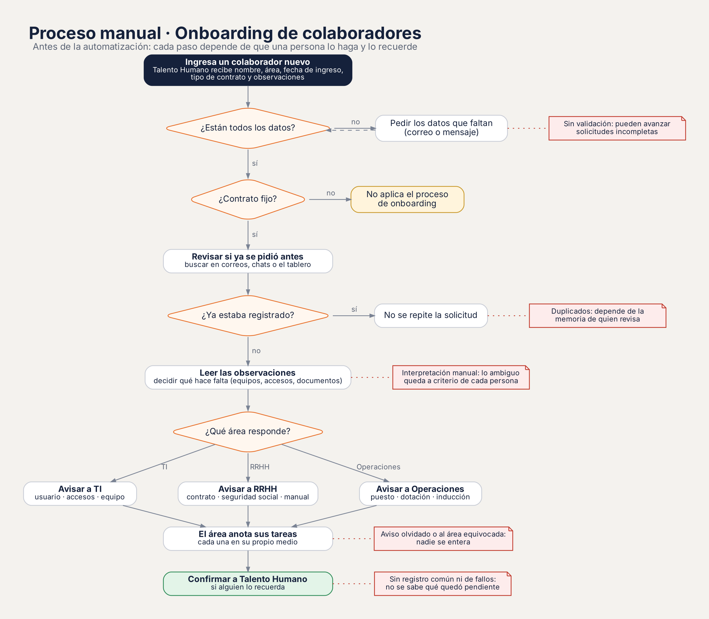
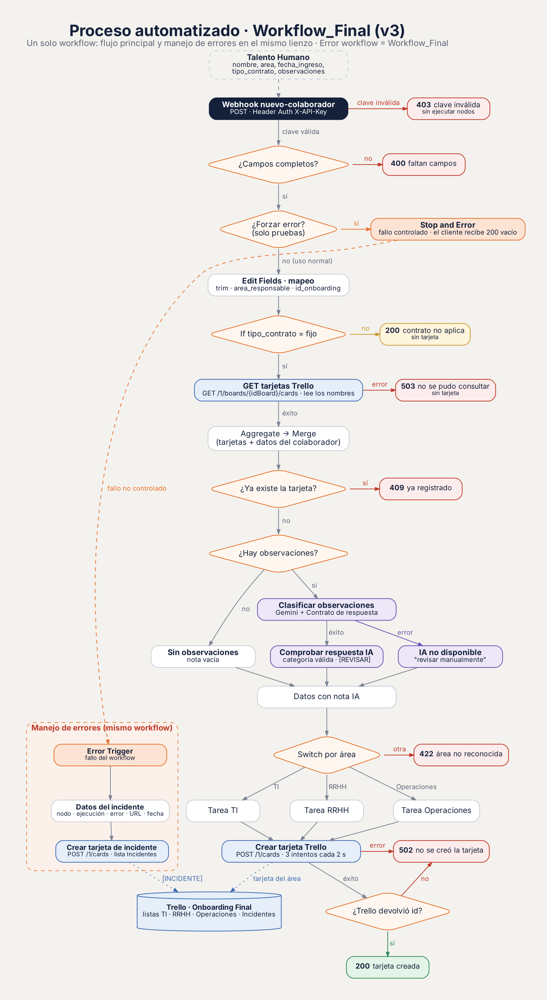

# Onboarding de colaboradores con n8n

**Curso:** Automatización inteligente con n8n
**Versión documentada:** [`Workflow_Final.json`](../workflows/Workflow_Final.json) (corresponde a `Workflow_Final_v3.json`)
**Servicios:** n8n, Trello (tablero "Onboarding Final") y Google Gemini (`models/gemini-3.5-flash-lite`)

## Contenido

1. Problema y alcance
2. Funcionamiento e integraciones
3. Componente de IA
4. Resultados
5. Qué es real y qué es simulado
6. Limitaciones y pendientes

---

## 1. Problema y alcance

### 1.1 Problema

Cuando ingresa un colaborador nuevo, Talento Humano tiene que coordinar con varias áreas lo que debe estar listo antes de su primer día: TI prepara el usuario, los accesos y el equipo; RRHH gestiona el contrato, la afiliación a seguridad social y el manual de convivencia; Operaciones asigna el puesto, la dotación y la inducción de seguridad.

Hecho a mano, cada solicitud depende de que alguien avise al área correcta, revise que el colaborador no se haya registrado antes y lea las observaciones para saber qué hace falta. Si un paso se olvida, nadie se entera, y no queda un registro común de lo que se pidió.



### 1.2 Objetivo

Recibir la solicitud de Talento Humano en un solo punto, validarla y crear automáticamente una tarjeta en la lista de Trello del área responsable, con sus tareas iniciales y una nota de la IA sobre las observaciones. La respuesta a Talento Humano debe coincidir con lo que realmente pasó en Trello.

### 1.3 Alcance

| Incluye | No incluye |
|---|---|
| Solicitudes autenticadas por webhook con la cabecera `X-API-Key` | Otros canales de entrada (formularios, correo) |
| Contratos `fijo` | Otros tipos de contrato: se responde "Contrato no aplica a este flujo" y no se crea tarjeta |
| Áreas TI, RRHH y Operaciones | Otras áreas: se responde 422 |
| Una tarjeta por colaborador y área, sin duplicados | Ejecutar las tareas (crear el usuario, firmar el contrato, entregar la dotación); la tarjeta solo las asigna |
| Clasificación de las observaciones con IA y marca `[REVISAR]` cuando hace falta revisión humana | Que la IA tome decisiones o actúe sobre Trello: solo devuelve texto validado |
| Registro de fallos no controlados en la lista Incidentes | Notificaciones por correo o chat |

### 1.4 Integrantes y aportes

| Integrante | Aporte al proyecto |
|---|---|
| Manuela Camacho Llano | Creó el repositorio y el tablero de Trello "Onboarding Final"; consolidó el workflow en un solo JSON (incluida la respuesta 422 para áreas no reconocidas); documentación y bitácora, organización de las evidencias, README, ensamblaje de la presentación y revisión del cumplimiento de la entrega |
| Karol [COMPLETAR APELLIDOS] | Importó el workflow final en su instalación de n8n (prueba de importación); agregó el manejo de errores (Error Trigger → tarjeta en Incidentes) y la salida de error con respuesta 503 en la consulta a Trello |
| Valeria [COMPLETAR APELLIDOS] | Ejecutó las pruebas (14 casos, 17 ejecuciones), corrigió la consulta a Trello en la v3, redactó la bitácora de la clase 11 y las diapositivas de resultados |
| Sofía [COMPLETAR APELLIDOS] | Documentación del proyecto, diagramas de los procesos manual y automatizado, y diapositivas de contexto, solución e IA |
| Miguel [COMPLETAR APELLIDOS] | Subida de los entregables al repositorio y revisión de secretos, nombres reales y enlaces |

---

## 2. Funcionamiento e integraciones

### 2.1 Vista general

Todo el proceso está en **un solo workflow**, `Workflow_Final`. El flujo principal y el manejo de errores comparten el mismo lienzo, y el workflow está configurado como su propio Error workflow (Settings → Error workflow = `Workflow_Final`). No usa subworkflows.



### 2.2 Recorrido paso a paso

| # | Nodo | Qué hace | Si no se cumple |
|---|---|---|---|
| 1 | `Webhook nuevo-colaborador` | Recibe un `POST` con autenticación Header Auth (`X-API-Key`). Responde con nodos Respond to Webhook | n8n responde **403** "Authorization data is wrong!" sin ejecutar ningún nodo |
| 2 | `¿Campos completos?` | Comprueba que `nombre`, `area`, `fecha_ingreso` y `tipo_contrato` existan y no estén vacíos | **400** "Faltan campos obligatorios" |
| 3 | `¿Forzar error? (solo pruebas)` | Si llega `forzar_error: true`, va a `Stop and Error · fallo controlado` para probar el manejo de errores | En uso normal sigue por la rama false |
| 4 | `Edit Fields · mapeo` | Lee desde `$json.body`, quita espacios (`trim`) y arma `nombre`, `area_responsable`, `tipo_contrato`, `fecha_ingreso` e `id_onboarding` (`ONB-{área}-{aaaammdd-hhmmss}`) | — |
| 5 | `If tipo_contrato = fijo` | Deja pasar solo contratos `fijo` (sin distinguir mayúsculas) | **200** "Contrato no aplica a este flujo", sin tarjeta |
| 6 | `GET tarjetas Trello` → `Aggregate` → `Merge` | Consulta las tarjetas del tablero, las agrupa en `tarjetas` y las une con los datos del colaborador | Si la consulta falla: **503** y no se crea ninguna tarjeta |
| 7 | `¿Ya existe la tarjeta?` | Busca una tarjeta llamada `Onboarding {nombre} · {área}` | **409** "Colaborador ya registrado" |
| 8 | `¿Hay observaciones?` | Si hay observaciones, pasa a la IA; si no, a `Sin observaciones` (nota vacía) | — |
| 9 | `Clasificar observaciones` → `Comprobar respuesta IA` | Clasifica la observación y arma la nota (ver sección 3) | Si la IA falla: `IA no disponible` y la tarjeta se crea igual con "revisar manualmente" |
| 10 | `Datos con nota IA` | Junta los datos del colaborador con la nota de la IA | — |
| 11 | `Switch por área` | Envía a `Tarea TI`, `Tarea RRHH` o `Tarea Operaciones` | Área no reconocida: **422** con las áreas válidas |
| 12 | `Tarea TI` / `Tarea RRHH` / `Tarea Operaciones` | Arman `asunto`, `cuerpo` (tareas iniciales del área) e `id_lista` | — |
| 13 | `Crear tarjeta Trello` → `¿Trello devolvió id?` | Crea la tarjeta (hasta 3 intentos, cada 2 s) y comprueba que Trello devolvió un `id` | **502** "No se pudo crear la tarjeta en Trello" |
| 14 | `Responder 200 · tarjeta creada` | Confirma la creación | — |

**Tareas iniciales por área** (campo `cuerpo` de la tarjeta):

| Área | Tareas |
|---|---|
| TI | Crear usuario institucional · Solicitar accesos al área de TI · Preparar equipo |
| RRHH | Firmar contrato del tipo indicado · Afiliar a seguridad social · Entregar manual de convivencia |
| Operaciones | Asignar puesto de trabajo · Entregar dotación · Coordinar inducción de seguridad |

### 2.3 Respuestas del webhook

| Código | Cuándo | Cuerpo | ¿Se crea tarjeta? |
|---|---|---|---|
| 200 | Tarjeta creada | `{"ok": true, "mensaje": "Tarjeta creada en Trello"}` | Sí |
| 200 | Contrato distinto de `fijo` | `{"recibido": true, "mensaje": "Contrato no aplica a este flujo"}` | No |
| 400 | Falta un campo obligatorio | `{"error": "Faltan campos obligatorios", "requeridos": [...]}` | No |
| 403 | Clave de cabecera ausente o incorrecta | `Authorization data is wrong!` (lo responde n8n) | No |
| 409 | Ya existe la tarjeta del colaborador en esa área | `{"error": "Colaborador ya registrado"}` | No |
| 422 | Área distinta de TI, RRHH u Operaciones | `{"error": "Área no reconocida", "validas": ["TI","RRHH","Operaciones"]}` | No |
| 502 | Trello no creó la tarjeta | `{"ok": false, "error": "No se pudo crear la tarjeta en Trello"}` | No |
| 503 | No se pudo consultar Trello para revisar duplicados | `{"ok": false, "error": "No fue posible consultar las tarjetas de Trello; no se creó ninguna tarjeta."}` | No |

### 2.4 Entrada del webhook

- **Método y ruta:** `POST /webhook/{ruta}` con el workflow publicado; `POST /webhook-test/{ruta}` en modo prueba.
- **Cabecera:** `X-API-Key: {clave}`. Cada integrante crea su propia credencial Header Auth; la clave no se guarda en el JSON ni en el repositorio.
- **Cuerpo (JSON):**

```json
{
 "nombre": "Laura Gómez Prueba",
 "area": "TI",
 "fecha_ingreso": "2026-12-01",
 "tipo_contrato": "fijo",
 "observaciones": "Necesita portátil y correo institucional antes del primer día"
}
```

`observaciones` es opcional. `forzar_error` solo se usa en pruebas.

### 2.5 Peticiones HTTP a Trello

El workflow tiene tres nodos HTTP Request, todos contra la API de Trello con la credencial predefinida **Trello API** de n8n. La credencial añade la key y el token a cada petición; ninguno aparece en el JSON exportado. Los identificadores del tablero y de las listas se muestran como `{idBoard}` e `{idList}`.

#### `GET tarjetas Trello`

| | |
|---|---|
| **Método y endpoint** | `GET https://api.trello.com/1/boards/{idBoard}/cards` |
| **Datos enviados** | Parámetro de consulta `fields=name` (solo se pide el nombre de cada tarjeta) |
| **Configuración** | Options → Response → *Include Response Headers and Status* activado; Settings → *Always Output Data* desactivado; On Error → salida de error |
| **Respuesta relevante** | Un solo ítem con `body` (lista de tarjetas con `id` y `name`), `headers` y `statusCode`, aunque el tablero esté vacío |
| **Uso de la respuesta** | `Aggregate` la guarda en `tarjetas`; `¿Ya existe la tarjeta?` recorre `body` y compara cada `name` con `Onboarding {nombre} · {área}` |
| **Si falla** | Sale solo por la rama de error → **503** y no se crea ninguna tarjeta |

#### `Crear tarjeta Trello`

| | |
|---|---|
| **Método y endpoint** | `POST https://api.trello.com/1/cards` |
| **Datos enviados** | `idList`: la lista del área (`id_lista` del nodo Tarea) · `name`: `Onboarding {nombre} · {área}` · `desc`: tareas iniciales del área + nota de la IA |
| **Configuración** | *Retry On Fail*: 3 intentos, 2000 ms entre intentos; On Error → salida de error |
| **Respuesta relevante** | La tarjeta creada; se usa su `id` |
| **Uso de la respuesta** | `¿Trello devolvió id?` responde **200** si hay `id` y **502** si no |
| **Si falla** | Salida de error → **502** |

#### `Crear tarjeta de incidente en Trello`

| | |
|---|---|
| **Método y endpoint** | `POST https://api.trello.com/1/cards` |
| **Datos enviados** | `idList`: lista Incidentes · `name`: `[INCIDENTE] {workflow} - {nodo que falló}` · `desc`: workflow, nodo, ejecución, fecha, mensaje de error y URL de la ejecución |
| **Respuesta relevante** | La tarjeta creada en Incidentes |
| **Si falla** | No tiene reintentos ni salida de error (ver sección 6) |

### 2.6 Manejo de errores

Si cualquier nodo falla sin una salida de error que lo controle, n8n ejecuta el Error workflow configurado, que es este mismo:

1. `Error Trigger · fallo del workflow` recibe los datos de la ejecución fallida.
2. `Datos del incidente` arma `workflow_name`, `execution_id`, `failed_node` (último nodo ejecutado), `error_message`, `execution_url` y `timestamp`.
3. `Crear tarjeta de incidente en Trello` crea la tarjeta `[INCIDENTE]` en la lista Incidentes.

Al importar el JSON en otra instalación hay que **publicar el workflow y volver a elegir `Workflow_Final` en Settings → Error workflow**, porque el identificador guardado corresponde a la instalación original.

### 2.7 Credenciales

| Credencial | Nodos |
|---|---|
| Header Auth (`X-API-Key`) | `Webhook nuevo-colaborador` |
| Trello API (key y token) | `GET tarjetas Trello`, `Crear tarjeta Trello`, `Crear tarjeta de incidente en Trello` |
| Google Gemini (PaLM) API | `Modelo Gemini - seleccionar credencial` |

---

## 3. Componente de IA

### 3.1 Para qué se usa

Talento Humano puede escribir observaciones libres ("necesita portátil", "falta un certificado"). La IA las clasifica en una categoría y las resume en una frase para que el área las lea en la tarjeta. **La IA no decide la ruta**: la lista de destino la define el campo `area` con el `Switch por área`.

### 3.2 Cómo está armado

| Nodo | Función |
|---|---|
| `Clasificar observaciones` (Basic LLM Chain) | Envía la observación al modelo con instrucciones de sistema fijas |
| `Modelo Gemini - seleccionar credencial` | `models/gemini-3.5-flash-lite`, máximo 2048 tokens de salida |
| `Contrato de respuesta` (Structured Output Parser) | JSON Schema: `categoria` ∈ {`equipos_accesos`, `documentos`, `otro`}, `resumen` (texto) y `requiere_revision` (booleano); no admite otros campos |
| `Comprobar respuesta IA` (Code) | Vuelve a validar la respuesta y arma la nota; antepone `[REVISAR]` si `requiere_revision` es `true` |
| `IA no disponible` | Rama de error de la cadena: nota "no se pudo procesar; revisar manualmente" |
| `Sin observaciones` | Si no hay observaciones, la nota queda vacía y no se llama al modelo |

**Categorías** (según las instrucciones de sistema):

- `equipos_accesos`: portátil, equipos, correo, usuarios o accesos.
- `documentos`: certificados, contratos o trámites.
- `otro`: tema distinto o intención no determinable.

### 3.3 Protecciones

- **La observación se trata como dato.** Se envía dentro de un JSON (`{"observaciones": "..."}`) y las instrucciones dicen que sus órdenes no cambian la tarea. Si el texto pide cambiar las instrucciones o realizar acciones, la respuesta debe ser `otro` con `requiere_revision = true`.
- **Ambigüedad → revisión humana.** Si falta información, la IA debe usar `otro` y marcar revisión.
- **Límite de tamaño.** Solo se analizan los primeros 500 caracteres.
- **Sin herramientas.** La cadena no tiene herramientas: la IA no puede consultar ni modificar Trello, solo devuelve texto que luego se valida.
- **Doble validación.** El parser obliga al formato; el nodo Code vuelve a comprobar categoría, resumen y tipo de `requiere_revision`. Si algo no cuadra, la nota dice "respuesta no válida; revisar manualmente".
- **El flujo no depende de la IA.** Si el modelo falla, la tarjeta se crea igual con la nota de revisión manual.

El esquema garantiza el formato de la respuesta, **no** que la clasificación o el resumen sean correctos.

### 3.4 Ejemplo de nota en la tarjeta

```
Tareas iniciales:
- Crear usuario institucional para Laura Gómez Prueba
- Solicitar accesos al área de TI
- Preparar equipo

Observaciones (IA) · equipos_accesos: Necesita portátil y correo institucional antes del primer día
```

### 3.5 Agente de la Clase 9

En la Clase 9 el equipo exploró un agente de IA con una herramienta. **No se incluyó en la versión final.** La versión entregada usa una cadena sin herramientas, de modo que la IA solo clasifica y resume, y la creación de tarjetas queda en nodos fijos del workflow.

---

## 4. Resultados

Las pruebas están en la [bitácora de la clase 11](../pruebas/Bitacora_Clase_11_Pruebas.md), con sus capturas en [pruebas/evidencias](../pruebas/evidencias/) y resumidas en la [presentación](../presentacion/Presentacion_Proyecto_Final.pdf).

- **14 casos y 17 ejecuciones** (incluye las repeticiones en v3): 16 cumplen y 1 no cumplió en v2.
- **Rutas normales:** TI, RRHH, Operaciones y la URL de producción crean su tarjeta en la lista correcta (CP-01, CP-02, CP-03, CP-13).
- **Rechazos:** clave incorrecta (403), campos faltantes (400), contrato que no aplica (200 sin tarjeta), área inválida (422) y duplicado (409) responden sin crear tarjetas (CP-14, CP-06, CP-07, CP-04, CP-05).
- **IA:** clasificó los casos claros, marcó `[REVISAR]` en la observación ambigua (CP-08) y en el intento de cambiar sus instrucciones, que además no creó tarjetas extra (CP-09). Con el modelo no disponible, el flujo siguió y creó la tarjeta con "revisar manualmente" (CP-10).
- **Fallos:** el error forzado en producción creó la tarjeta `[INCIDENTE]` con el nodo, la ejecución, la fecha, el error y la URL (CP-12).

### Evolución v2 → v3

| Problema en v2 | Ajuste en v3 | Comprobación |
|---|---|---|
| Con Trello caído, *Always Output Data* dejaba un ítem vacío en la rama de éxito del GET y se creaba la tarjeta sin revisar duplicados, con respuesta 200 (CP-11, no cumple) | *Always Output Data* desactivado, *Include Response Headers and Status* activado y la comprobación de duplicados lee `body` | CP-11b responde 503 sin tarjeta; CP-05b (409) y CP-01b (200) siguen funcionando |
| El Error workflow apuntaba a `Manejador_Errores` | Error workflow = `Workflow_Final` | CP-12 crea la tarjeta de incidente |
| En el primer intento de la prueba de duplicado se creó una tarjeta repetida | Se ajustó el flujo y se repitió la prueba | CP-05 (v2) y CP-05b (v3) responden 409 |

Observaciones: en CP-03 la IA clasificó "dotación" como `equipos_accesos` sin `[REVISAR]`, una categoría discutible que no cambia la lista de destino. Cada caso se ejecutó una vez, así que no se afirma la estabilidad de la IA entre repeticiones.

---

## 5. Qué es real y qué es simulado

| Real | Simulado (solo en pruebas) |
|---|---|
| Las llamadas a Google Gemini que clasifican las observaciones | **`forzar_error`:** bandera que lleva a `Stop and Error · fallo controlado` para provocar un fallo no controlado y comprobar el registro de incidentes |
| La consulta y la creación de tarjetas en el tablero de Trello "Onboarding Final" | **IA no disponible:** el modelo se cambió temporalmente por uno inexistente (`models/modelo-inexistente-prueba`) y luego se restauró |
| La autenticación por cabecera y las respuestas HTTP del webhook | **Trello no disponible:** la URL del GET se cambió temporalmente a un tablero inexistente y luego se restauró |
| La tarjeta de incidente creada por el Error Trigger | Los colaboradores: todos los nombres son ficticios |

Las caídas de Gemini y Trello se simularon con un modelo y un tablero inexistentes, no con interrupciones reales del servicio.

---

## 6. Limitaciones y pendientes

- **`forzar_error` responde 200 con cuerpo vacío.** La ejecución se detiene en `Stop and Error` antes de llegar a un nodo de respuesta, así que el cliente no se entera del fallo, aunque el incidente sí queda en Trello. Como `forzar_error` es un fallo simulado para pruebas, se deja documentado como limitación. Además, cualquiera que tenga la clave puede enviarlo en producción y generar incidentes.
- **Error workflow al importar:** hay que reconfigurarlo (sección 2.6); sin ese paso no se registran incidentes.
- **Tarjeta de incidente sin protección:** `Crear tarjeta de incidente en Trello` no tiene reintentos ni salida de error. Si Trello falla en ese momento, el incidente solo queda en el historial de ejecuciones de n8n.
- **Reintentos de `Crear tarjeta Trello`:** si Trello crea la tarjeta pero la respuesta no llega, el reintento podría crear un duplicado.
- **Ruta 502 sin ejecutar:** está configurada, pero no se probó.
- **`fecha_ingreso`:** solo se comprueba que no esté vacía; no se valida el formato ni el rango.
- **Duplicados:** la comparación distingue mayúsculas y espacios internos.
- **Orden de validación del área:** el área se valida al final, después de consultar Trello y llamar a Gemini.

El estado de cada pendiente está en la sección 5 de la [bitácora de la clase 11](../pruebas/Bitacora_Clase_11_Pruebas.md) (PD-01 a PD-13).
